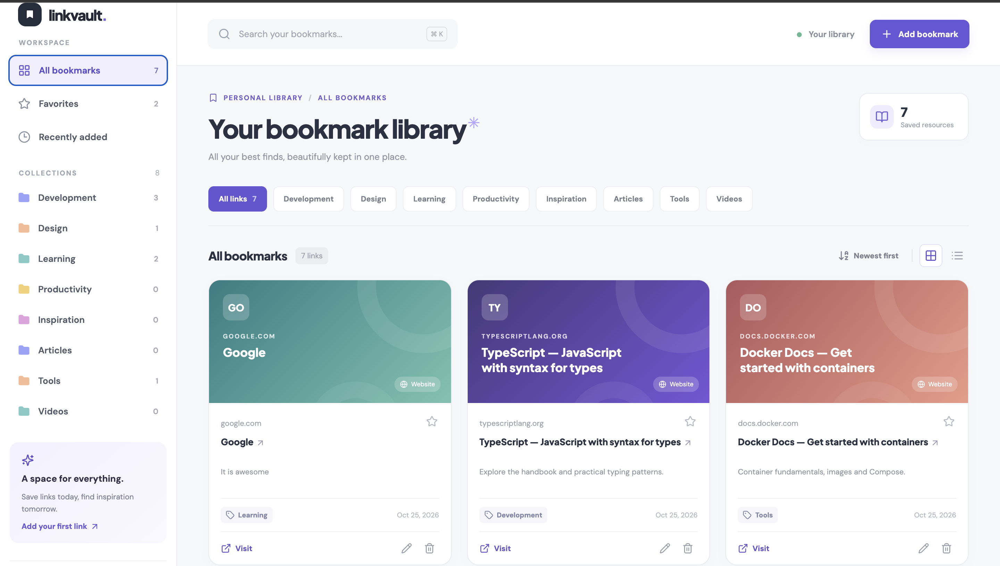
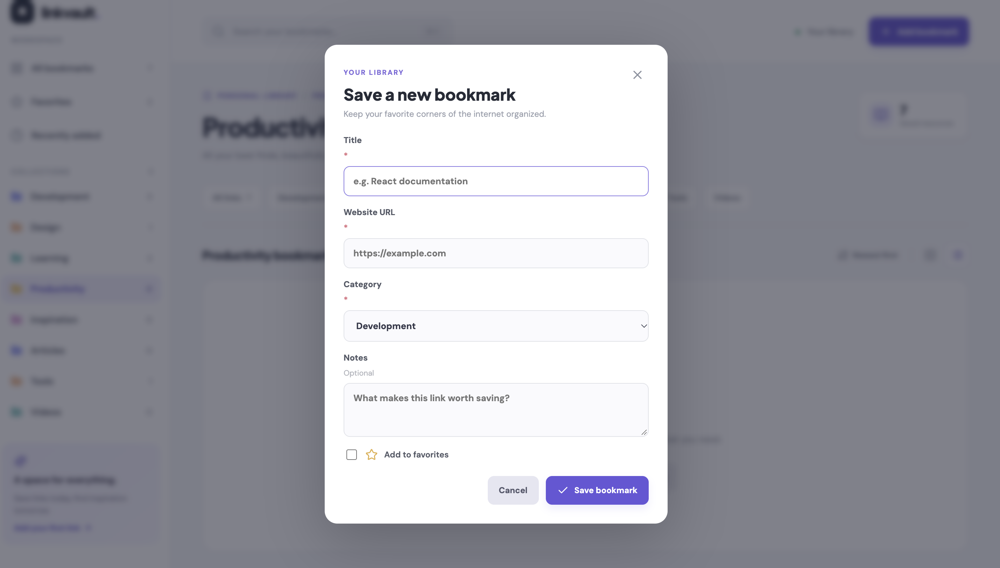

# LinkVault 

A responsivefull-stack bookmark management application for saving, organizing, searching, and managing useful resources through a clean, structured interface. It combines a responsive React frontend with a Spring Boot REST API and persistent local storage. The project focuses on practical full-stack engineering concepts including CRUD workflows, API design, validation, persistence, testing, containerization, and frontend/backend integration. Using **Load sample links** for a six-bookmark demo.


**Features:**
1. Create, edit, delete, and favorite bookmarks
2. Search across titles, URLs, notes, and categories
3. Filter resources by category
4. View recently added bookmarks
5. Sort saved resources
6. Switch between grid and list layouts
7. Load sample bookmarks for demonstration
8. Persistent bookmark storage across application restarts
9. User-friendly validation and API error handling
10. Responsive interface for desktop and smaller screens

## Architecture

```text
Browser
  │
  ▼
React + TypeScript + Vite
  │
  │ REST / JSON
  ▼
Spring Boot API
  │
  ├── Controller
  │
  ├── Service
  │
  └── JPA Repository
        │
        ▼
    H2 Database
```

The frontend communicates with the backend through REST endpoints under /api/bookmarks.

The backend follows a layered structure separating request handling, business logic, persistence, and data models.

### Engineering Focus
This project demonstrates:
- full-stack application architecture
- REST API design
- CRUD workflows
- frontend/backend integration
- persistent data storage
- request validation
- API testing
- containerized development
- maintainable separation of application layers


## Demo:

**1.Main Dashboard with all Categories:**


**2. Adding a new bookmark:**



## Run the Demo:
Note: LinkVault is a local project, not a hosted website. You run it on your Mac or through Docker Compose. Opening the GitHub repository shows the code; it does not automatically make the app live on the Internet.

### 1. Open the project

1. Download the ZIP and double-click it to unzip.
2. Open **VS Code** → **File → Open Folder...** → choose the inner **`linkvault`** folder (the one with `frontend/`, `backend/`, and `compose.yaml`).
3. In VS Code click **Terminal → New Terminal**.

### Option A — Easiest: Docker Compose (one command)

Install and start [Docker Desktop](https://www.docker.com/products/docker-desktop/) for Apple Silicon / your Mac. In the project's top-level `linkvault` directory:

```bash
docker compose up --build
```

Open **http://localhost:3000** in your browser. The first build downloads dependencies and container images. To shut down: press **Ctrl+C** and run `docker compose down`. Bookmark data remains in a named Docker volume; **do not run** `docker compose down -v` unless you intentionally want to delete your local bookmarks.

### Option B — Run frontend and backend separately

Requires **Java 21**, **Node.js 20.19+ or 22+**, and Internet access for initial dependencies. The included `mvnw` script automatically fetches Maven 3.9.11 the first time if Maven is not installed. Yarn is invoked through Corepack so you don't need a global Yarn install.

**Terminal 1 — backend** (from the project directory):

```bash
cd backend
./mvnw spring-boot:run
```

Backend is at **http://localhost:8080/api/bookmarks**. Keep this terminal open.

**Terminal 2 — frontend** (open a *new* VS Code terminal at project root):

```bash
cd frontend
corepack yarn install
corepack yarn dev
```

Open **http://localhost:5173**. Vite proxies requests beginning with `/api` to your backend. When done, press **Ctrl+C** in both terminals. On the Mac, if `./mvnw` says permission denied, run `chmod +x mvnw` in `backend/` then retry.

> **Why two terminals?** React draws the webpage on port 5173. Spring Boot processes bookmark requests on port 8080. H2 saves bookmarks in `backend/data/` (created on first run).

## 2. Try the app

1. Click **Add bookmark**. Enter title, `https://` website URL, category and optional notes.
2. Click **Save bookmark**. The new card appears in your library.
3. Use **Search** (or **⌘K**) and category chips to find it.
4. Click the **star** for Favorites; use the **pencil** to edit and **trash** to delete.
5. Switch between grid/list views. Restart LinkVault and verify your bookmark is still there.

**The dashboard starts empty by design.** Click **Load sample links** for pre-filled cards; do not expect the 234 bookmarks from the reference screenshot.

## 3. Verify the backend with Postman

1. Install [Postman](https://www.postman.com/downloads/).
2. Start the backend in Terminal 1 (or Docker; Docker keeps port 8080 internal by default, so for Postman run Terminal 1).
3. In Postman, choose **Import** → select `postman/LinkVault.postman_collection.json`.
4. Run the eight numbered requests **in order**, or use the Collection Runner. Creation records the `bookmarkId` collection variable for edit/delete checks.
5. Expected responses: `201`, `200`, `200`, `200`, `204`, `400`, `400`, `404`.

Run Java automated API tests from `backend/`:

```bash
./mvnw test
```

Run a production frontend build from `frontend/`:

```bash
corepack yarn build
```

## 4. Push it to GitHub

**No GitHub CLI (`gh`) is required**. This route avoids the previous `zsh: command not found: gh` problem.

1. Go to **https://github.com/new** while signed in. Set repository name to **`linkvault`** and choose Public or Private.
2. **Do not** check “Add a README”, `.gitignore`, or license (they are already included locally). Click **Create repository**.
3. In VS Code, **Terminal → New Terminal**, in the **top-level `linkvault` folder** (not `frontend` or `backend`):

```bash
git init
git add .
git commit -m "Build LinkVault full-stack bookmark manager"
git branch -M main
git remote add origin https://github.com/YOUR_GITHUB_USERNAME/linkvault.git
git push -u origin main
```

**Important:** Replace `YOUR_GITHUB_USERNAME` with the username shown in the top-right of your GitHub account, not your name from the Mac terminal. The repository *must exist* on GitHub before `git push`, or you can get “Repository not found.”

If `origin` already exists, instead of `git remote add origin ...` run:

```bash
git remote -v
git remote set-url origin https://github.com/YOUR_GITHUB_USERNAME/linkvault.git
```

If `git push` asks for a GitHub password: GitHub does not accept account passwords for HTTPS Git; use a **personal access token** or authenticate with GitHub CLI. For CLI setup, run `brew install gh` (if Homebrew is installed), `gh auth login`, `gh auth setup-git`, then retry `git push`. If `gh` is installed but the shell says “command not found”, run it via its installed `bin/gh` path or open a new terminal after installing; there is no need to edit a protected `.zshrc` file just to publish this project.

You can also use VS Code's **Source Control → Publish to GitHub** after signing into GitHub there.

## 5. Mapping

```text
Browser
  └── React + TypeScript + Vite (dev: 5173 / Docker: 3000)
       └── /api/bookmarks JSON requests
            └── Java Spring Boot (8080)
                 └── Controller → Service → JPA Repository
                      └── H2 file database (survives app restarts)
```

| Route | What it does | Success |
| --- | --- | --- |
| `GET /api/bookmarks` | List all saved bookmarks | 200 |
| `GET /api/bookmarks/{id}` | Read one bookmark | 200 |
| `POST /api/bookmarks` | Add a bookmark | 201 |
| `PUT /api/bookmarks/{id}` | Edit a bookmark / favorite | 200 |
| `DELETE /api/bookmarks/{id}` | Remove a bookmark | 204 |

Invalid required fields or URLs return **400**; missing IDs return **404**.

## 6. Project structure

```text
linkvault/
├── frontend/                  React/TypeScript app + nginx Dockerfile
│   ├── src/App.tsx           Bookmark UI and API actions
│   └── src/styles.css        Styling and responsive layout
├── backend/                   Spring Boot REST API + H2 persistence
│   ├── mvnw                   Maven bootstrap script for Mac/Linux
│   ├── pom.xml                Java dependencies
│   └── src/                   Controllers, service, entity and tests
├── postman/                   Exported API request/test collection
├── compose.yaml               Starts both services with persistent H2 volume
└── README.md                  This guide
```
### Future Improvements
Potential extensions include:
- user authentication
- cloud-hosted persistence
- bookmark tagging
- import/export support
- richer link previews
- shared bookmark collections
- pagination for larger libraries
- production deployment

### Notes

- Local H2 data is excluded from Git by `.gitignore`, so your personal bookmarks are not published.
- The interface uses illustrated text cards rather than automatically fetched website previews; live previews, authentication, and cloud hosting are intentionally outside the MVP scope.
- Docker Compose uses `linkvault_data` for persistent H2 storage. Don't mix the Docker database with `backend/data` and expect the same bookmarks; these are separate storage locations.
